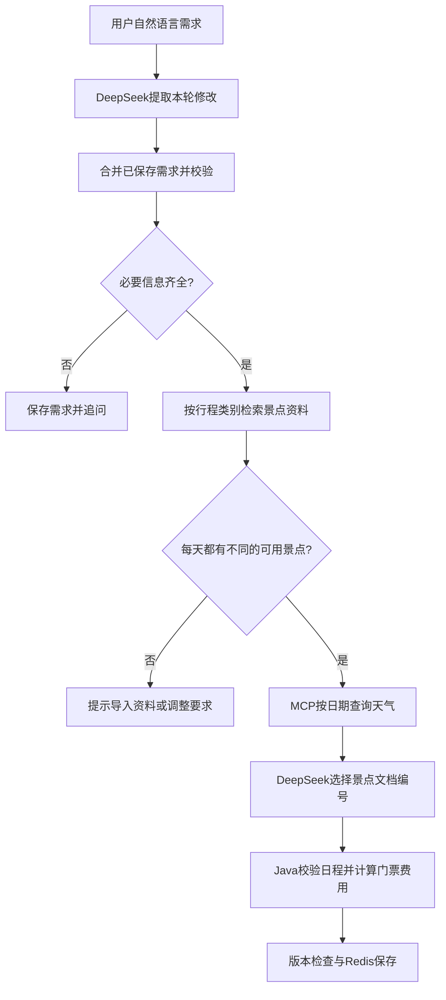

# 行程规划阶段

## 用户能做什么

用户输入“周末去杭州玩两天，单人预算1000元，喜欢自然风景，不想安排太赶”，系统提取需求，检索景点资料并查询天气，生成按天排列的行程。缺少出发日期、天数或预算时先追问；同一会话可继续说“第二天全部换成室内活动”或“把预算改为100元”。

当前提供后端结构化接口，尚未接入聊天页面。行程与聊天可以使用同一conversationId，但分别存储；行程不会随着最近20条聊天记录被裁剪。

## 一次规划如何执行



这是显式编排的行程工作流：模型负责需求理解和候选选择，Java决定阶段顺序、调用MCP、执行硬约束与保存。没有新增多Agent系统，也没有把固定流水线描述成已经实现Plan-Execute-Replan图。现有聊天接口仍使用之前的ReAct Agent。

## 启动与演示

先按 [MCP阶段说明](mcp-agent-stage.md) 启动Docker基础设施、tools-server和后端。后端使用：

```powershell
cd backend
mvn -s maven-central-settings.xml spring-boot:run '-Dspring-boot.run.profiles=deepseek,postgres,redis,local-embedding,agent'
```

回到项目根目录导入行程演示景点：

```powershell
./scripts/import-itinerary-demo.ps1
```

脚本读取data/itinerary-attractions.json，通过已有知识入库接口导入6个杭州虚构景点及演示价格，并生成本地模型向量。固定UUID使重复导入更新相同演示文档，不新增重复资料。全部景点、票价及开放规则仅用于演示，不是实际旅游资料。

规划接口：

```powershell
$body = @{conversationId='hangzhou-trip';message='明天去杭州玩两天，单人预算1000元，喜欢自然风景，慢节奏。'} | ConvertTo-Json -Compress
Invoke-RestMethod http://localhost:8080/api/itineraries/plan -Method Post -ContentType 'application/json; charset=utf-8' -Body ([System.Text.Encoding]::UTF8.GetBytes($body))
```

修改同一份行程：

```powershell
$body = @{conversationId='hangzhou-trip';message='第二天全部改成室内活动，其他要求不变。'} | ConvertTo-Json -Compress
Invoke-RestMethod http://localhost:8080/api/itineraries/plan -Method Post -ContentType 'application/json; charset=utf-8' -Body ([System.Text.Encoding]::UTF8.GetBytes($body))
Invoke-RestMethod http://localhost:8080/api/itineraries/hangzhou-trip
```

相对日期按Asia/Shanghai的当前日期计算，不要照抄过去的演示日期。未来365天内均可生成资料驱动的行程；天气仅今天至未来第6天可查，且每请求最多4次查询，其余日期注明未获取。

## 返回数据

| 字段 | 含义 |
| --- | --- |
| version | 保存版本，每次成功更新加1 |
| requirements | 城市、日期、天数、单人预算、偏好与室内天序号 |
| status | 规划阶段状态 |
| clarification | 缺信息或缺资料时的提示 |
| plan.days | 每天日期、景点顺序、资料编号、游览时长、天气及室内备选 |
| plan.ticketSubtotal | 所选景点的单人门票费用合计，由Java计算 |
| warnings | 演示资料、天气缺失及预算范围说明 |

状态包括NEEDS_INFORMATION（补充需求）、NEEDS_KNOWLEDGE（缺少可用景点）、READY（通过日程校验）、TICKET_BUDGET_EXCEEDED（已知门票费用超预算）。READY只表示已知门票与日程约束通过，不代表真实出游预算完整满足。

HTTP 400表示参数或需求值无效，404表示未保存，409表示同会话版本冲突，502表示模型失败或计划校验不通过，503表示未启用DeepSeek。失败不会覆盖上一份已保存行程。读取最新状态后再重试冲突请求。

## 如何导入自己的景点

沿用POST /api/knowledge/documents，category为itinerary-attraction。每个景点单独一个短JSON文档，content示例：

```json
{"name":"你的景点名称","city":"杭州","indoor":true,"ticketPrice":30,"visitHours":2,"source":"资料来源与核实日期","demo":false,"closedWeekdays":[1]}
```

closedWeekdays的1至7为周一至周日，空数组表示该资料未列出固定闭馆日。ticketPrice与visitHours必须是数值；source必须有内容。effectiveDate可填写政策生效日期，晚于出发日期的资料不会使用。demo=false应由资料维护者在核实数据后设置，不代表程序自动验证真实性。

普通景区介绍与票务文档仍用于客服RAG，不会被当作可计算价格与闭馆日的结构化景点。JSON必须完整落在一个文档块中（现有分块上限800字符）；不完整或非法元数据将被排除。检索最多20个行程类别候选，再校验城市及字段。

## 校验与保存

- 天数1至7、预算大于0、室内天序号不超出天数；相对日期由模型提取，Java再验证范围。
- 每天1至3处景点、累计游览时长不超过6小时；不生成精确交通时间。跨天不重复安排景点。
- 景点必须来自当前检索结果，符合闭馆日和用户明确的室内要求。先用匹配算法检查每天是否能分配不同的可用景点，再调用规划模型。
- 局部修改室内要求时保留其他天的已选景点；全局修改城市、日期、天数、预算或偏好时重新规划。资料变化导致原景点失效时不强行保存。
- 室内备选只是候选，不自动替换或加入费用。预算仅包含已知单人门票；交通、住宿、餐饮、预约费用需要另外核实。
- 默认内存保存，重启丢失；redis模式使用24小时TTL，Lua脚本原子比较版本后写入，防止旧请求覆盖新结果。
- 每次完整规划通常调用两次DeepSeek（提取、选择），不完整需求只提取。模型单次等待上限45秒，天气调用受现有MCP超时限制；此接口目前为同步JSON响应。

## 验证

离线测试使用本机模型接口与测试资料，不消耗线上Key。真实存储测试需要Docker服务：

```powershell
cd backend
$env:TOURMATE_INTEGRATION='true'
mvn -s maven-central-settings.xml clean verify
Remove-Item Env:TOURMATE_INTEGRATION
```

测试覆盖缺字段追问、资料类别隔离、日期／室内／闭馆／时长／重复校验、预算说明、局部修改、失败保留、并发版本、模型JSON解析、天气失败与上限、HTTP错误、Redis序列化与TTL。

2026-10-13最终验证：后端59项与工具服务3项共62项全部通过，含7项真实PostgreSQL／Redis测试，失败、错误、跳过均为0。

真实DeepSeek＋本地Qwen3＋MCP联调记录：

- 缺少日期、天数、预算时返回追问，补充后生成2026-10-14至15日的两天行程，天气来源为Open-Meteo。
- 第二天改为室内展馆后，第一天的公园与历史馆保持不变；新版本保存成功。
- 单人预算降至1元并重新规划后，选择两处免费演示景点，已知门票合计0元，仍明确其他费用未计。
- 周末按当天日期换算为2026-10-17，补充慢节奏后保留原有“自然风景”偏好，生成两天行程且两日天气均成功获取。
- 后端重启后，Redis中保存的行程版本与内容仍可读取。

联调发现模型有时把偏好返回为字符串数组，已补回归并仅将纯文本数组转换为逗号连接的字符串。模型编号选择仍可能不符合约束，此时返回502且保留旧行程，可调整要求或重试；不会静默保存不合规计划。

## 后续工作

仍需Vue前端、检索Rerank、限流、统一评测和部署整理。本阶段没有地图路径、实时景区预约、真实订单交易或完整旅行总费用估算；这些能力不应写成已完成成果。
