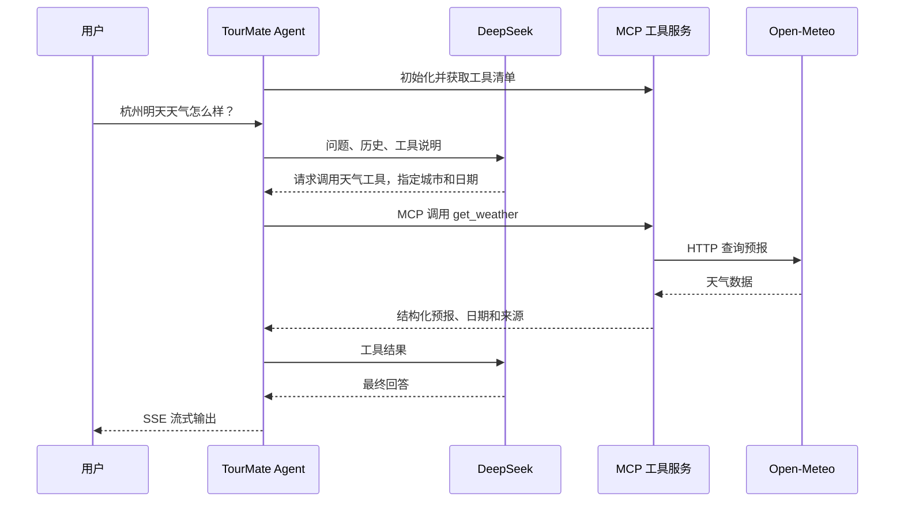

# Agent 与 MCP 工具阶段

## 本阶段实现

用户问“杭州明天天气怎么样，适合去西湖吗？”，系统查询真实天气，再由 DeepSeek 组织回答。追问“那后天呢？”会沿用会话城市并查询新日期。还可以查询虚构订单 DEMO-1001，或根据上传的票务资料咨询价格、证件和退改政策。

已接入 Spring AI Alibaba ReAct Agent 与独立 Java MCP 工具服务。对话仍使用 DeepSeek，向量仍使用 Ollama 本地 Qwen3。使用 Alibaba 开源框架不要求调用阿里云模型，不需要 DashScope Key。

## MCP 是什么

MCP（Model Context Protocol，模型上下文协议）是让 AI 应用连接工具与数据源的标准协议。工具服务说明自己能做什么、需要哪些参数，客户端按统一格式发现与调用工具，再将结果交给模型。

例如查询天气：模型提出“调用天气工具，城市杭州，日期明天”的请求，Java 代码负责执行。MCP 服务内部仍可调用普通 HTTP 天气接口。MCP 统一的是工具发现、参数说明和通信，并不代替天气数据源，也不代表授权模型执行退款。

| 角色 | 项目对应内容 | 职责 |
| --- | --- | --- |
| AI 应用／Host | TourMate 后端与 ReAct Agent | 整理问题、历史和资料，让模型选择工具并生成回答 |
| MCP 客户端／Client | 后端 McpSyncClient | 初始化连接、读取工具清单、发送调用请求 |
| MCP 服务端／Server | 独立 tools-server | 发布工具，校验参数，执行天气与演示订单查询 |



ReAct 是“判断—调用工具—观察结果—继续判断”的执行方式；Tool Calling 是模型提出工具名和参数的能力；MCP 是应用与工具服务之间的通信协议。

Agent 模式按模型轮次暂存文本，确认该轮没有工具调用后才通过 SSE 发送片段，避免把“我先查一下”等中间输出存成最终回答。因此此模式目前不保证模型首个 Token 到达时立即展示；普通 DeepSeek 模式保留直接转发流式片段。

## 启动

环境：Java 21、Maven、Docker Desktop。项目根目录 `.env` 填写 DEEPSEEK_API_KEY，不要提交该文件。

第一个终端，在项目根目录启动基础设施；模型仅首次需要下载：

```powershell
cd infra
docker compose --profile local-embedding up -d
docker compose exec ollama ollama pull qwen3-embedding:0.6b
```

第二个终端先启动 MCP 服务：

```powershell
cd tools-server
mvn -s ../backend/maven-central-settings.xml spring-boot:run '-Dspring-boot.run.jvmArguments=-Djava.net.useSystemProxies=true'
```

工具服务绑定 `127.0.0.1:18090`，端点 `/mcp`，使用 Streamable HTTP。该端点不是普通业务 REST 接口。JVM 参数让 Java 使用操作系统代理；无需代理时可以省略，不要在源码硬编码本机代理端口。

第三个终端启动后端，必须同时启用 deepseek 和 agent：

```powershell
cd backend
mvn -s maven-central-settings.xml spring-boot:run '-Dspring-boot.run.profiles=deepseek,postgres,redis,local-embedding,agent'
```

后端默认 8080。PostgreSQL 模式需先导入文档，见 [本地向量检索说明](local-embedding-stage.md)。`.env` 可设置 TOURMATE_MCP_BASE_URL 修改客户端地址；工具服务端口由进程环境变量 TOURMATE_TOOLS_PORT 设置。

```powershell
$body = @{conversationId='weather-demo';message='杭州明天天气怎么样？请注明日期和来源。'} | ConvertTo-Json -Compress
Invoke-RestMethod http://localhost:8080/api/chat -Method Post -ContentType 'application/json; charset=utf-8' -Body ([System.Text.Encoding]::UTF8.GetBytes($body))
```

也可以问“查询演示订单 DEMO-1001 的景区和票价”。订单是虚构青岚湖景区的 18 元未使用门票，不是交易凭证。

## 工具与限制

- get_weather 支持北京、上海、杭州、南京、苏州、成都、西安、广州、深圳、武汉、桂林、厦门；日期为中国时区今天至未来第 6 天。非法参数或上游失败返回失败，不生成假天气。
- get_demo_order 只返回固定演示订单，未知编号返回未找到。
- 后端只注册这两个只读工具；SDK 可能添加名称前缀，例如 j_get_weather。
- 每请求最多尝试 4 次工具调用，参数最多 1000 字符，图递归限制 14。模型流无新输出 60 秒超时，HTTP SSE 生命周期上限为 120 秒。
- MCP 请求超时 25 秒；天气连接超时 5 秒，读取超时 15 秒。工具调用日志只记录工具名。
- MCP 没有退款执行工具；现有退款确认接口仅演示状态变更，令牌 5 分钟一次有效，不执行支付退款。

版本：Spring Boot 3.5.9、Spring AI 1.1.2、Alibaba Agent Framework 1.1.2.4-security-fix、MCP Java SDK 0.17.0。

## 验证与当前边界

2026-10-13 真实联调：DeepSeek 经 MCP 查询杭州 2026-10-14 天气，返回预报日期、气温及 Open-Meteo 来源；追问后天查询 2026-10-15，SSE 正常结束，Redis 保存两轮 4 条消息。演示订单回答标注虚构；本地向量检索后回答学生票 18 元及证件，并附引用。退款令牌首次确认成功，重复失败，无真实交易。

自动化测试覆盖 MCP 初始化、工具发现与调用、天气参数和失败响应、模型—工具—模型循环，以及原有知识库、会话与确认流程。模型测试额外覆盖先输出中间文本、随后调用工具的场景，保证中间文本不会进入最终答案。默认 CI 不调用付费模型。重新验证：

最终 clean verify：后端 37 项（包含 6 项真实数据库测试）与工具服务 3 项全部通过，失败、错误、跳过均为 0。逐轮缓冲修复后的真实天气 SSE 返回 46 个答案片段及 done，Redis 保存完整的用户与助手消息。

```powershell
cd backend
$env:TOURMATE_INTEGRATION='true'
mvn -s maven-central-settings.xml clean verify
Remove-Item Env:TOURMATE_INTEGRATION
cd ../tools-server
mvn -s ../backend/maven-central-settings.xml clean verify
```

当前是本机演示系统：MCP 只使用 tools，没有 resources、prompts；Redis 提供历史窗口，未实现 Agent 图检查点持久化；工具服务没有公网鉴权，只绑定本机。服务重启使客户端会话失效时可重启后端重新初始化。

规则意图标签与模型工具选择是两个步骤，订单查询标签可能是 UNKNOWN 或 REFUND_POLICY，不代表执行退款。引用仍为候选检索资料，未做生成引用校验和 Rerank。

后续已实现结构化行程工作流，见 [行程规划阶段](itinerary-stage.md)。Vue前端、限流、检索优化和统一评测仍未完成；简历目标稿中的未实现能力不能作为已完成成果或量化收益。
