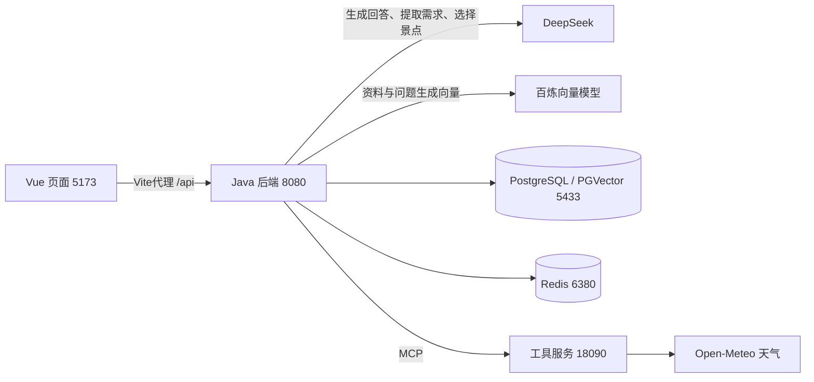

# TourMate AI 逐文件代码职责与调用流程

本文根据2026-10-14仓库实际代码整理。先理解用户操作经过哪些文件，再查逐文件清单。下面每张表的文件名都相对于该表注明的目录；接口、数据类、配置和测试也逐一列出，避免把“声明结构”和“执行业务”混在一起。

启动命令单独见 [启动与关闭指南](启动与关闭指南.md)。本文描述当前实现，不把简历目标稿中的Rerank、限流、真实退款等当作已实现能力。

## 一、项目到底由什么组成

| 目录 | 通俗理解 | 当前承担的工作 |
| --- | --- | --- |
| frontend | 用户看到和点击的页面 | 聊天、行程、上传与搜索，显示接口结果 |
| backend | 处理业务的Java程序 | 检索资料、调用模型、编排行程、保存状态、处理HTTP接口 |
| tools-server | 独立的Java工具服务 | 通过MCP提供真实天气和固定演示订单查询 |
| infra | 运行基础设施的配置 | PostgreSQL/PGVector、Redis，可选Ollama |
| data、scripts | 可复现的演示资料与操作 | 导入结构化景点 |
| docs | 项目说明与开发记录 | 启动、设计、实现边界及学习资料 |

当前页面不会直接调用DeepSeek或百炼。浏览器只调用Java后端；后端才拿Key访问模型。

## 二、先串起四条主要流程

### 1. 用户问“演示景区学生票多少钱”

1. `ChatPanel.vue` 获取输入，调用 `api.js` 的 `streamChat()`，POST到 `/api/chat/stream`。
2. `ChatController.java` 建立SSE响应，把工作交给 `ChatService.java`。
3. `ChatService.stream()` 根据conversationId读历史，简单补全“那……”“它……”等追问，再调用 `TourmateAgent.answer()`。
4. `TourmateAgent` 使用 `IntentRouter` 的关键词规则判断意图，调用 `KnowledgeRepository.search()` 获取最多2条候选资料，并处理是否需要退款确认等业务状态。
5. 当前选中 `JdbcKnowledgeRepository`：先由 `EmbeddingClient` 请求百炼把问题转为1024维向量，再到PGVector计算相似度，并结合数据库全文检索得分排序；只检索来源与当前模型一致的向量。
6. `GenerationPrompt` 将历史、资料编号、问题和业务状态组织为提示词。`AlibabaAgentAnswerGenerator` 用DeepSeek和Alibaba ReAct Agent生成答案；需要天气或订单时，模型可以通过MCP调用工具。
7. `ChatService` 发送meta、delta、done；完整回答生成后才把本轮用户消息和回答交给 `RedisConversationStore` 保存。
8. `api.js` 解析流事件，`ChatPanel.vue` 更新回答；done中的候选资料显示为可展开引用，编号是否实际引用以回答为准。

注意：当前知识检索是在生成前由Java执行，不是让模型通过MCP检索知识库；`IntentRouter` 是关键词路由，不是训练出的分类模型。Agent模式为避免中间工具思考文本进入答案，会按模型轮次缓冲，不能宣称每个Token一产生就立刻送达页面。

### 2. 用户上传一份票务说明

`KnowledgePanel.vue` → `KnowledgeController.upload()` → `KnowledgeImportService.importFile()` → `DocumentTextExtractor.extract()`提取文字 → `TextChunker.split()`切块 → `JdbcKnowledgeRepository.save()`生成向量并保存 → 返回filename和chunks。

`KnowledgeImportService` 会先按块生成独立的知识文档；JDBC仓库也在保存入口执行分块，以处理直接通过JSON新增的长文档。这两处服务各自负责自己的入口，通常已分好的短块不会再被拆开。前端显示的是导入文本块数，不是PDF页数。

普通资料进入客服知识库。行程景点还需要city、ticketPrice、visitHours、indoor、closedWeekdays等字段，因此不能把任意景区PDF直接当作可校验的行程数据。

### 3. 用户要求“明天去杭州两天，预算1000”

`TripPanel.vue` → `ItineraryController.plan()` → `ItineraryService.plan()`，再执行：

1. 从 `RedisItineraryStore` 读旧需求与版本。
2. `DeepSeekItineraryModel.extract()` 把用户话语提取为结构化需求；`TripRequirements.merge()` 合并未修改字段。
3. Java校验日期、预算、天数。缺城市等必要信息时保存追问状态，不生成假行程。
4. `AttractionCatalog.search()` 只查询行程资料分类，解析并验证JSON、城市、票价、时长、闭馆日等。
5. `McpItineraryWeather.fetch()` 查询可用日期天气；超范围或失败明确标记不可用。
6. `DeepSeekItineraryModel.schedule()` 让模型从候选资料中选择景点编号，不允许自己创造景点价格。
7. `ItineraryService.validateAndBuild()` 再校验编号、闭馆、室内限制、重复景点和每天时长；用BigDecimal计算单人门票总额。
8. 通过带预期版本号的 `save()` 保存新状态；并发版本冲突返回409，生成失败不覆盖旧状态。

“第二天改室内”会尽量保留未受影响的日程。它是Java组织的多步骤工作流，不应笼统说成模型自主完成任意长任务。当前预算仅核验已知门票，未计算住宿、餐饮、交通，也没有真实地图导航。

### 4. 用户说“我要退票”

`TourmateAgent` 识别明确操作短语 → `RefundService.requestConfirmation()` 生成5分钟内有效的随机令牌 → done事件返回确认状态 → `ChatPanel.vue` 显示演示按钮 → 用户点击并接受二次弹窗 → `/api/refunds/confirm` → `RefundService.confirm()` 移除并验证令牌。

令牌移除后无法重复使用。这里没有接支付平台或真实订单退款，模型和MCP都没有退款执行权限。咨询退票政策本身不会自动创建退款申请。

## 三、Java后端逐文件职责

本节Java目录前缀均为 `backend/src/main/java/com/tourmate/`。

### 应用入口与HTTP接口

| 文件 | 职责与已实现功能 |
| --- | --- |
| `TourmateApplication.java` | main入口。启动Spring Boot，扫描并组装控制器、业务服务、存储等Bean。它不写具体问答逻辑。 |
| `api/HealthController.java` | GET `/api/health`，返回UP和服务名。用于检查HTTP服务存活，不代表全部外部依赖都可用。 |
| `api/ChatController.java` | POST同步问答、SSE问答、演示退款确认；建立120秒SSE生命周期，连接关闭时取消订阅，异常时发送中文错误。 |
| `api/ChatRequest.java` | 聊天请求结构：message、conversationId。用NotBlank阻止空消息。 |
| `api/StreamEvent.java` | 流事件结构：type和data。承载meta、delta、done，供控制器转换为SSE。 |
| `api/KnowledgeController.java` | 提供知识新增、搜索、文件上传三个HTTP入口；限制搜索数量，将非法参数和向量服务异常转为错误响应。 |
| `api/KnowledgeMaintenanceController.java` | postgres模式的向量重建入口 `/api/knowledge/reindex`；支持每批1至20块和可选文档UUID。 |
| `api/ItineraryController.java` | POST生成/修改行程、GET读取行程；校验请求长度，区分400参数错误、404无记录、409冲突、502生成失败和503未启用。 |

### agent：基础业务判断

| 文件 | 职责与已实现功能 |
| --- | --- |
| `agent/Intent.java` | 意图枚举：退改政策、天气、景区信息、闲聊、未知。仅定义可用类别。 |
| `agent/IntentRouter.java` | `route()` 按中文关键词和优先级分类，例如先判断退改再判断天气。它是规则分类器。 |
| `agent/AgentResponse.java` | 问答返回结构：意图、答案、候选引用、是否需确认、确认令牌。同步接口和done共用。 |
| `agent/TourmateAgent.java` | 组合分类、知识检索、演示天气和退款规则，生成baseline业务结果。启用agent后不会先调用模拟天气，而是交给模型选择真实天气工具。 |

这里的 `TourmateAgent` 是业务规则入口；真正调用Alibaba ReAct框架的是下一节的 `AlibabaAgentAnswerGenerator`，不要因为类名含Agent就把两者看成同一层。

### chat：上下文、模型生成与MCP连接

| 文件 | 职责与已实现功能 |
| --- | --- |
| `chat/ChatService.java` | 聊天总协调。读取历史、补全简单追问、获取baseline、调用生成器、积累delta、完整结束后保存双方消息。同步answer复用流并收集最终结果。 |
| `chat/AnswerGenerator.java` | 定义生成器接口 `generate(context)`，返回Flux文本片段。业务无需关心当前是离线、普通DeepSeek还是工具Agent。 |
| `chat/GenerationContext.java` | 把本轮问题、历史列表、baseline结果一起传入生成器的数据结构。 |
| `chat/GenerationPrompt.java` | 共用提示词。把资料编号、历史、系统日期和业务状态加入上下文；约束政策依据、工具日期和退款表述，限制拼入内容长度。 |
| `chat/OfflineAnswerGenerator.java` | 未启用deepseek时使用baseline答案，支持无需模型Key的开发演示；不是故障时偷偷替换真实模型的兜底。 |
| `chat/DeepSeekAnswerGenerator.java` | deepseek且未启用agent时，用Spring AI ChatClient直接获取DeepSeek流式输出，设置60秒流空闲超时。 |
| `chat/AlibabaAgentAnswerGenerator.java` | 当前完整模式生成器。创建ReAct Agent，接入DeepSeek和受控工具；限制最多4次工具尝试、参数长度、图递归与空闲时间；过滤工具轮次中间文本，只发送最终回答轮次。 |
| `chat/McpAgentConfiguration.java` | 当前完整模式连接配置。初始化Streamable HTTP MCP客户端，发现工具，只允许get_weather和get_demo_order，并创建Agent生成器。未启动tools-server会导致初始化失败。 |

### conversation：聊天记录

| 文件 | 职责与已实现功能 |
| --- | --- |
| `conversation/ConversationMessage.java` | 单条消息：角色、正文、创建时间；简化构造时自动记录当前时间。 |
| `conversation/ConversationStore.java` | 存储接口：追加消息、读取最近消息，让业务不依赖Redis细节。 |
| `conversation/InMemoryConversationStore.java` | 非redis模式实现。每会话保存有限队列，默认最近20条，进程重启后丢失；读取和写入队列时同步。 |
| `conversation/RedisConversationStore.java` | 当前实现。Lua原子执行追加、截断到20条、刷新24小时TTL；JSON序列化保留时间戳，各会话使用独立Redis键。 |
| `conversation/ConversationController.java` | GET `/api/conversations/{conversationId}/messages`；前端刷新时恢复最近消息。只返回角色、正文和时间，不恢复引用或确认令牌。 |

### knowledge：资料解析、向量与检索

| 文件 | 职责与已实现功能 |
| --- | --- |
| `knowledge/KnowledgeDocument.java` | 文档结构及字段校验：编号、标题、正文、分类、生效日期。 |
| `knowledge/KnowledgeSearchResult.java` | 一条检索命中：文档与分数；前端引用和知识搜索共用。 |
| `knowledge/KnowledgeRepository.java` | 保存、搜索及按分类搜索的统一接口；内存和JDBC可以替换实现。 |
| `knowledge/InMemoryKnowledgeRepository.java` | 非postgres模式。内置三份故宫示例，通过归一化中文字符命中打分；新增文档即刻可搜索，进程重启丢失。不是PGVector。 |
| `knowledge/JdbcKnowledgeRepository.java` | 当前知识存储。在保存事务中先生成向量，再更新文档、替换文本块；搜索使用余弦距离与全文得分之和，按分类和模型来源过滤，返回最高分结果。 |
| `knowledge/EmbeddingClient.java` | 调用向量服务的适配器。支持离线哈希、Ollama、百炼兼容HTTP；校验维度、数值和非零向量；生成来源标记；当前百炼Flash用1024维列，旧远端方案用1536维列。 |
| `knowledge/DocumentTextExtractor.java` | Apache Tika识别文件类型并提取正文，文本类型解析为空时尝试UTF-8读取，返回文件名、类型、正文。没有OCR流水线。 |
| `knowledge/TextChunker.java` | 按段落切分；长段落每块最多800字符、步进700，即最多100字符重叠，避免超长资料直接进入向量接口。 |
| `knowledge/KnowledgeImportService.java` | 文件上传业务。拒绝空文件和空正文，调用解析器、分块并保存，按文件名#序号命名，返回filename/chunks。 |
| `knowledge/KnowledgeReindexService.java` | 切模型后的资料维护。分批找旧来源或缺向量记录，重新生成；单条UPDATE校验旧正文和来源，避免并发编辑时写回过期向量；失败保留该条旧数据，返回剩余数与失败块。 |

当前检索不是独立BM25引擎，也没有RRF或Rerank模型；PostgreSQL使用simple全文配置，中文分词能力有限。`embedding_local` 虽然名字带local，目前也被1024维百炼模型复用；是否允许检索由 `embedding_identity` 判断，不是看列名。

### itinerary：行程规划

| 文件 | 职责与已实现功能 |
| --- | --- |
| `itinerary/TripRequirements.java` | 用户需求：城市、日期、天数、单人预算、偏好、室内天序号。统一城市后缀；merge只覆盖本轮非null字段，支持连续修改。 |
| `itinerary/TripState.java` | 行程会话整体状态：版本、需求、计划、状态、追问、警告。供保存和HTTP响应使用。 |
| `itinerary/ItineraryPlan.java` | 已校验计划结构，包含每日日期、景点Stop、天气、雨天备选和门票小计；它是数据结构，不自己安排景点。 |
| `itinerary/ItineraryModel.java` | 模型能力接口：extract提取需求，schedule选择每日景点编号；重载支持旧行程和固定日程。 |
| `itinerary/DeepSeekItineraryModel.java` | 用DeepSeek分别完成提取和选择，提示词包含中国日期、约束和候选；限制45秒调用、输出长度并严格解析JSON，兼容常见的偏好字符串数组。 |
| `itinerary/UnavailableItineraryModel.java` | 未启用deepseek时的实现，明确抛出未启用异常，避免离线模式伪造行程。 |
| `itinerary/ItineraryDisabledException.java` | 表达“行程模型未启用”的特定异常，控制器据此返回503。 |
| `itinerary/AttractionCatalog.java` | 从itinerary-attraction分类检索候选，验证JSON类型、城市、价格、时长、生效日期与闭馆日；过滤普通介绍文本和坏资料。内部Attraction对象可判断指定日期是否开放。 |
| `itinerary/ItineraryService.java` | 行程总协调。合并需求、追问、检查候选可分配性、查天气、调用模型、保留未修改日程、校验每天1至3处/不重复/每天不超6小时/室内与闭馆、计算门票、生成警告并保存版本。 |
| `itinerary/ItineraryWeather.java` | 行程天气接口及Forecast结构，明确区分available和unavailable，不把没查到天气当晴天。 |
| `itinerary/McpItineraryWeather.java` | 当前天气适配。通过MCP按日期调用get_weather，每次规划最多4次、仅今天起7天范围；校验返回城市、日期和来源，失败保留不可用原因。 |
| `itinerary/UnavailableItineraryWeather.java` | 未启用工具模式时，为每天返回天气不可用，不提供模拟预报冒充真实天气。 |
| `itinerary/ItineraryStore.java` | 行程存储接口：读取状态、按预期版本保存。用于隔离内存与Redis。 |
| `itinerary/InMemoryItineraryStore.java` | 非redis模式实现，ConcurrentHashMap.compute原子比对版本；进程重启后丢失。 |
| `itinerary/RedisItineraryStore.java` | 当前实现。Lua校验旧版本和新版本+1后保存JSON，TTL为24小时；不符则返回false，让业务转为409。不是持久化无限版本历史。 |

### refund与tool：演示确认和离线工具

| 文件 | 职责与已实现功能 |
| --- | --- |
| `refund/RefundConfirmation.java` | 确认令牌和过期时间的数据结构。 |
| `refund/RefundService.java` | 在ConcurrentHashMap中生成、保存和移除随机令牌；5分钟内单次有效。状态在内存，不在Redis；不对接支付退款。 |
| `tool/WeatherTool.java` | 早期业务天气接口，定义query和WeatherResult。与独立MCP工具服务的协议适配不是同一个接口。 |
| `tool/DeterministicWeatherTool.java` | 离线演示返回固定多云22℃。完整agent模式不走它；它不能说明项目查到了实时天气。 |

## 四、后端配置与数据库文件

| 文件（相对根目录） | 职责与生效条件 |
| --- | --- |
| `backend/pom.xml` | Maven依赖、Java/Spring版本、测试与Spring Boot打包插件；引入Spring AI、Alibaba框架、Tika、JDBC、Redis等。不是运行时密钥文件。 |
| `backend/maven-central-settings.xml` | Maven下载源设置，减少本机其他镜像配置对依赖下载的影响。命令中的 `-s` 选择它。 |
| `backend/src/main/resources/application.yml` | 基础配置：加载根目录或当前目录.env；默认关闭真实聊天/向量自动配置，配置开发用H2。 |
| `backend/src/main/resources/application-deepseek.yml` | 读取DeepSeek Key、base-url、model，启用兼容对话模型及连接参数；由deepseek profile加载。 |
| `backend/src/main/resources/application-agent.yml` | 开启agent业务标志、MCP基础地址；由agent profile加载。 |
| `backend/src/main/resources/application-embedding.yml` | 当前百炼远端向量：remote模式、北京兼容接口、Flash型号、DASHSCOPE_API_KEY。 |
| `backend/src/main/resources/application-local-embedding.yml` | 可选Ollama向量：ollama模式、本机接口、qwen3-embedding:0.6b。当前不启用。 |
| `backend/src/main/resources/application-postgres.yml` | PostgreSQL驱动、5433连接、开发账号及启动时补充结构的SQL路径；可用环境变量覆盖。 |
| `backend/src/main/resources/application-redis.yml` | Redis主机与6380端口，可用环境变量覆盖。 |
| `backend/src/main/resources/db/embedding-metadata.sql` | 为既有knowledge_chunks增加来源标记、1024维列和索引，使用IF NOT EXISTS避免重复创建。不是完整建库SQL。 |
| `infra/docker-compose.yml` | 定义postgres、redis及可选ollama容器、端口、健康检查和数据卷。云端向量只需前两个。 |
| `infra/postgres/init.sql` | 新数据库首次初始化：启用vector扩展，创建文档/块/全文索引/向量索引等；还建了conversation_messages表，但当前会话读写走Redis，不使用该表。 |

`@Profile` 可以理解为选择实现的开关：postgres决定知识库用内存还是JDBC；redis决定状态用内存还是Redis；deepseek和agent共同决定用哪种答案生成器。它们不是五个独立Java服务。

## 五、MCP工具服务逐文件职责

本节Java前缀为 `tools-server/src/main/java/com/tourmate/tools/`。

| 文件 | 职责与已实现功能 |
| --- | --- |
| `ToolsServerApplication.java` | 独立Spring Boot入口；注册WeatherTools、DemoOrderTools和ToolCallbackProvider，将带@Tool的方法发布给MCP。 |
| `WeatherTools.java` | get_weather工具：校验12个城市、ISO日期及7天范围，HTTP调用Open-Meteo，映射天气代码并返回温度、来源和抓取时间；失败明确success=false。 |
| `DemoOrderTools.java` | get_demo_order工具：只认识DEMO-1001，返回固定虚构18元未使用订单；其他编号未找到。没有真实订单数据库和写操作。 |
| `tools-server/src/main/resources/application.yml` | 绑定127.0.0.1:18090，配置SYNC、Streamable HTTP及/mcp端点，只发布工具能力。 |
| `tools-server/pom.xml` | 工具服务独立依赖、MCP服务端库与构建配置。与backend分别启动、分别打包。 |

MCP负责“发现工具和按协议调用”，Open-Meteo负责提供天气，DeepSeek负责决定是否调用及如何表述。三者职责不同。

## 六、Vue前端逐文件职责

| 文件（相对根目录） | 职责与已实现功能 |
| --- | --- |
| `frontend/package.json` | Vue、Vite、图标和Playwright依赖；定义dev/build/preview/test/test:e2e命令。 |
| `frontend/package-lock.json` | 锁定实际依赖版本和校验信息，使npm ci可复现安装；由npm维护，不手写业务逻辑。 |
| `frontend/index.html` | 浏览器HTML入口，提供挂载节点、中文语言和页面标题，加载main.js。 |
| `frontend/vite.config.js` | Vue编译插件、5173开发服务与4173预览服务，/api默认代理到8080；TOURMATE_BACKEND_URL只在Vite服务端读取。 |
| `frontend/src/main.js` | 创建Vue应用，加载App和全局样式，挂载到HTML。 |
| `frontend/src/App.vue` | 工作台框架、三个页签、连接状态与新会话；localStorage只保存会话编号和页签，生成时禁用导航。 |
| `frontend/src/api.js` | fetch封装、JSON错误转换、POST请求和SSE增量解析；处理跨UTF-8字节/网络块、多行、CRLF、取消、缺done和error事件。按后端格式保留空格片段。 |
| `frontend/src/components/ChatPanel.vue` | 聊天页面。恢复历史、提交问题、追加片段、停止生成、展示候选资料和未完成状态；仅使用后端令牌显示演示退款按钮，点击后二次确认。 |
| `frontend/src/components/TripPanel.vue` | 行程页面。读取已保存状态、提交自然语言需求/修改，展示追问、预算、每日景点、天气与来源；生成失败保留旧计划，409提示重新读取。 |
| `frontend/src/components/KnowledgePanel.vue` | 资料上传与检索。单文件1MB校验、FormData上传、分类、成功块数、搜索结果；所有资料以文本展示。 |
| `frontend/src/style.css` | 全局颜色、字体、侧栏、卡片、聊天区和响应式断点；山水插图也是CSS与SVG组合，不依赖外部图片。 |
| `frontend/playwright.config.js` | 浏览器测试目录、测试地址、自动启动开发服务；支持PLAYWRIGHT_CHANNEL=msedge使用本机Edge。 |
| `frontend/scripts/live-smoke.mjs` | 手工真实联调脚本，需TOURMATE_LIVE=true；上传演示资料、查向量、调用DeepSeek、恢复历史、可选恢复行程、截图。会产生模型调用及写入，非默认离线测试。 |
| `frontend/tests/api.test.js` | Node测试SSE分片、空格、多行、服务错误、无done、HTTP错误及预先取消。 |
| `frontend/e2e/workspace.spec.js` | 用模拟后端跑浏览器交互：问答引用和确认、行程失败保留与恢复、上传和安全文本展示、手机宽度及会话编号更新。 |

界面未用v-html渲染模型或资料，所以答案中的Markdown符号可能直接显示；当前重点是安全文本展示，不是完整Markdown排版。刷新历史接口不含引用与令牌，因此刷新后需重新提问才能重新看到引用和确认按钮。

## 七、后端和工具服务测试逐文件职责

后端测试目录为 `backend/src/test/java/com/tourmate/`。测试文件不参与生产业务；它们用断言验证代码行为，通常通过模拟HTTP或测试模型避免付费调用。

| 文件 | 验证什么 |
| --- | --- |
| `HealthControllerTest.java` | 健康接口返回UP。 |
| `TourmateAgentTest.java` | 景区回答携带资料、退款需确认、政策咨询不创建操作、未知问题兜底；Agent模式不提前用模拟天气。 |
| `ToolConfirmationTest.java` | 确认令牌只能使用一次。 |
| `KnowledgeRepositoryTest.java` | 内存检索的退票资料优先及新增可检索。 |
| `KnowledgeUploadTest.java` | Markdown上传后可检索，空文件被拒绝。 |
| `DocumentTextExtractorTest.java` | 正文提取与文件元信息。 |
| `TextChunkerTest.java` | 段落切分、长文长度和重叠、空内容跳过。 |
| `EmbeddingClientTest.java` | 百炼Flash1024维、Ollama、旧远端1536维、编码参数、鉴权、坏向量校验和错误不泄露Key。 |
| `ConversationStoreTest.java` | 内存会话窗口截断与不同会话隔离。 |
| `ConversationControllerTest.java` | HTTP读取最近消息。 |
| `ChatServiceTest.java` | 将历史和资料传给生成器、保存实际答案、发送分片；生成失败不伪造助手记录。 |
| `ChatHttpTest.java` | HTTP问答保存历史并支持追问，SSE发送预期事件。 |
| `DeepSeekClientTest.java` | Spring AI发送上下文，并消费兼容接口的模拟流响应。 |
| `AlibabaAgentTest.java` | 模型—工具—模型循环；包含中间文本的工具轮次不会成为最终回答。 |
| `StorageProfilesTest.java` | 默认与postgres/redis配置只选择一套对应存储实现。 |
| `StorageIntegrationTest.java` | 真实PostgreSQL/Redis：保存与检索、向量来源隔离、分块、分批重建、失败与并发编辑、消息窗口时间、行程版本及过期。需TOURMATE_INTEGRATION=true。 |
| `ItineraryHttpTest.java` | 行程HTTP需求收集与读取、参数错误、生成错误和未启用503。 |
| `ItineraryModelTest.java` | 模型提示词与结构化JSON解析、天气调用上限和失败/超范围标记。 |
| `ItineraryServiceTest.java` | 需求追问、室内修改与固定日程、预算、资料不足、闭馆/重复/时长校验、失败保留和版本并发冲突。 |
| `tools-server/src/test/java/com/tourmate/tools/WeatherToolsTest.java` | 天气请求城市日期、返回来源、参数校验、上游失败不伪造天气。 |
| `tools-server/src/test/java/com/tourmate/tools/McpProtocolTest.java` | 通过真实本地MCP协议初始化、发现工具和参数Schema、调用只读工具。天气上游可模拟，不等于每次测试都联网查天气。 |

## 八、数据、开发配置和CI

| 文件（相对根目录） | 职责 |
| --- | --- |
| `.env`（本机文件，不进Git） | 存放真实模型Key和可选覆盖值，由后端读取，不供前端读取；不在本文展示内容。 |
| `.env.example` | 无真实Key的配置模板，说明DeepSeek、百炼、可选Ollama及MCP变量。 |
| `.gitignore` | 排除密钥、target、node_modules、dist、Vite缓存、浏览器报告等。 |
| `data/itinerary-attractions.json` | 6份虚构杭州景点的结构化资料，包含价格、时长、室内属性、闭馆和来源，用于可复现行程演示。 |
| `scripts/import-itinerary-demo.ps1` | 读取上述JSON并调用知识新增接口，固定编号使重复导入更新同份资料；不是每次启动必须运行。 |
| `.github/workflows/backend.yml` | push/PR时在GitHub安装Java21，分别执行后端和工具服务clean verify；默认不启用本机真实数据库集成测试。 |
| `.github/workflows/frontend.yml` | push/PR时安装Node22与npm依赖，运行API测试、构建及Chromium浏览器模拟接口测试，无需Key。 |

自动生成目录如 `backend/target/`、`tools-server/target/`、`frontend/node_modules/`、`frontend/dist/`、`.vite/`、`test-results/` 不逐个解释：它们是编译结果、依赖或报告，通常不手改。`.git/` 是Git内部数据库，也不属于业务源码。

## 九、每份项目文档负责什么

这些文件是说明，不会被应用作为业务代码执行。早期设计记录是历史方案，和当前运行方式有差异时，以当前配置及本次启动指南为准。

| 文件（相对根目录） | 用途 |
| --- | --- |
| `README.md` | 项目入口、能力概览、接口与阶段文档导航。 |
| `docs/启动与关闭指南.md` | 当前百炼方案的完整启动、验证、关闭、常见错误处理。 |
| `docs/代码职责与调用流程.md` | 本文，逐文件职责与四条主流程。 |
| `docs/deepseek-stage.md` | DeepSeek接入、配置与模型流输出阶段说明。 |
| `docs/storage-stage.md` | PostgreSQL/PGVector与Redis阶段配置和存储边界。 |
| `docs/embedding-stage.md` | 当前百炼低价向量型号、价格、profile及重建方法。 |
| `docs/local-embedding-stage.md` | 可选Ollama本地向量方案，当前不需要执行。 |
| `docs/mcp-agent-stage.md` | MCP角色与通信、ReAct和工具服务实现及限制；含可选本地向量启动示例。 |
| `docs/itinerary-stage.md` | 行程资料格式、工作流、接口、校验及预算边界。 |
| `docs/frontend-stage.md` | Vue使用、启动、测试、会话恢复和部署边界。 |
| `docs/implementation-plan.md` | 总体分阶段计划和当前进度，含未完成扩展项。 |
| `docs/resume-project.md` | 简历目标描述，部分内容是预期能力；投递前必须与真实可演示实现对齐。 |
| `docs/superpowers/specs/2026-10-13-embedding-design.md` | 本地向量与重建阶段设计。 |
| `docs/superpowers/specs/2026-10-13-mcp-agent-design.md` | 工具Agent与MCP阶段设计。 |
| `docs/superpowers/specs/2026-10-13-itinerary-design.md` | 行程规划需求与边界设计。 |
| `docs/superpowers/specs/2026-10-14-web-design.md` | Vue三个工作台页面与交互设计。 |
| `docs/superpowers/plans/2026-10-13-embedding.md` | 本地向量阶段的实施步骤记录。 |
| `docs/superpowers/plans/2026-10-13-mcp-agent.md` | MCP工具阶段的实施步骤记录。 |
| `docs/superpowers/plans/2026-10-13-itinerary.md` | 行程阶段的实施步骤记录。 |
| `docs/superpowers/plans/2026-10-14-web.md` | Vue阶段任务与验证记录。 |
| `docs/superpowers/plans/2026-10-14-bailian-embedding.md` | 百炼低价模型选择、1024维适配、重建和回归记录。 |

## 十、建议怎么学，而不是一次把所有文件背下来

第一遍只跟一条问答：`ChatPanel.vue` → `api.js` → `ChatController` → `ChatService` → `TourmateAgent` → `JdbcKnowledgeRepository` → `GenerationPrompt` → `AlibabaAgentAnswerGenerator` → `RedisConversationStore`。弄清每个文件接收什么、调用谁、返回什么。

第二遍沿上传入口走到数据库，拿一份短文对照原文、块和向量，区分“解析文字”和“理解问题”两个环节。

第三遍读 `ItineraryService`，再看模型与存储接口。重点解释为什么模型只能挑编号、价格要Java重算、版本为什么能阻止覆盖。

最后读对应测试，理解它们防住什么错误。面试时能用真实请求讲完整流程，比背技术名词更有用；未实现的Rerank、生产鉴权、限流、真实退款和完整费用规划要明确说明。
